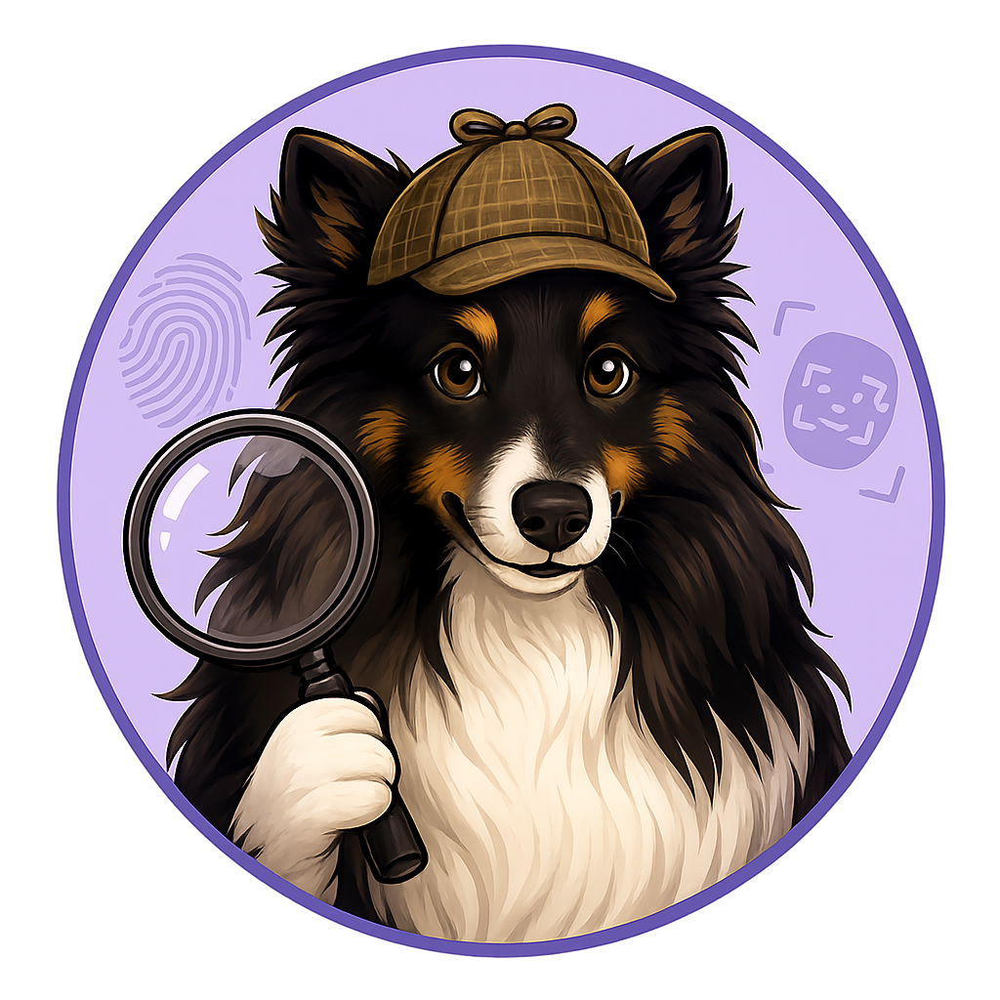

# DEFTOR (DEepFake deTection platfORm)

Deepfake detection platform (`DEFTOR`) is a Python Command-Line Interface (CLI) application that can be used to run analysis on user-given media (whatever the model-at-hand can handle, *i.e. text/images/videos/audio*) to check whether they contain AI-generated elements or not.

DEFTOR supports both `Ollama` and `Hugging Face` models. HF models are used through the [transformers](https://huggingface.co/docs/transformers/en/index) framework/library and Ollama models are used through the [Ollama Python Library](https://github.com/ollama/ollama-python).

## Quick-start
All you need to do is clone this repository locally and run the following command to get started:
```sh
./installation_linux.sh && source .venv/bin/activate
```
> Currently only supports Linux systems.

During the installation, DEFTOR asks the user whether they want to install some models that are supported by default. The available default models are listed below:

| Name | Type | Platform | Size |
| :-- | :--- | :------ | :--- |
| [llava](https://ollama.com/library/llava) | image | Ollama | 4.7GB |
| [gemma3:12b](https://ollama.com/library/gemma3:12b) | image | Ollama | 8.1GB |
| [llama3.2-vision:11b](https://ollama.com/library/llama3.2-vision:11b) | image | Ollama | 7.8GB |
| [dima806/deepfake_vs_real_image_detection](https://huggingface.co/dima806/deepfake_vs_real_image_detection) | image | Hugging Face | 3.78GB |
| [prithivMLmods/Deep-Fake-Detector-v2-Model](https://huggingface.co/prithivMLmods/Deep-Fake-Detector-v2-Model) | image | Hugging Face | 1.37GB |
| [Organika/sdxl-detector](https://huggingface.co/Organika/sdxl-detector) | image | Hugging Face | 1.74GB |
| [mo-thecreator/Deepfake-audio-detection](https://huggingface.co/mo-thecreator/Deepfake-audio-detection) | audio | Hugging Face | 0.379GB |
| [Hemgg/Deepfake-audio-detection](https://huggingface.co/Hemgg/Deepfake-audio-detection) | audio | Hugging Face | 0.378GB |
| [MelodyMachine/Deepfake-audio-detection-V2](https://huggingface.co/MelodyMachine/Deepfake-audio-detection-V2) | audio | Hugging Face | 0.378GB |
| [Vansh180/VideoMae-ffc23-deepfake-detector](https://huggingface.co/Vansh180/VideoMae-ffc23-deepfake-detector) | video | Hugging Face | 0.378GB |

## Standard Usage examples
### Analysis
DEFTOR will differentiate between Ollama and Hugging Face models by the model name. Typically, all Hugging Face models contain the `/` character and if the model name has that, it will treat it as a Hugging Face model. If you want to use a Hugging Face model that does not contain `/`, or an Ollama model that contains `/`, you need to use the `--backend <ollama|huggingface>` argument.

#### Analyze and print output into CLI
```
deftor analyze path/to/image_or_folder -m llava
```
> DEFTOR will check whether the input path is a single image or a folder and will analyze every file with an appropriate file extension under that folder. If you have multiple folders under a folder and you wish to analyze the contents in them as well, use the `--subfolders` argument.

#### Analyze and save output into a file
```
deftor analyze path/to/image_folder -m dima806/deepfake_vs_real_image_detection --subfolders -o filename -f json
```
> DEFTOR will save the analysis into `/current/working/directory/analyses/filename.json`. To save the results into another folder, use the `-d/--destination` argument.

### Model management
#### List all models
```
deftor model list
```

#### Download a model
```
deftor model pull <model_name>
```

#### Delete a model
```
deftor model delete <model_name>
```

## Additional usage
Generate a report based on the analysis results files. This functionality is only supported for runs that have been executed with datasets and the results are saved into a JSON file. If you are looking to replicate the tests that were executed through `thesis_test.sh`, there is no need to explicitly run this command as the script itself will run it after the testing has finished.
```
deftor report
```

## Thesis data
The DEFTOR repository also contains a `thesis_data` folder, which contains the following subfolders and files:
- `analyses`
  - Contains the analysis results in JSON format that are used in the thesis
  - These files are used to check how many of the media were analyzed correctly against the labels
- `audio`
  - Audio datasets that were analyzed in the thesis (`deepfake-audio-detection` and `hemg-deepfakeaudio`) and their labels
- `image`
  - Image datasets that were analyzed in the thesis and their labels
- `video`
  - Video dataset that was analyzed in the thesis and its labels
- `statistics.csv`
  - `.csv` file of all the runs under `analyses`

The datasets that have been used for testing are listed below:

| Name                                                        | Modality |
| :---------------------------------------------------------- | :------: |
| [saakshigupta/deepfake-detection-dataset-v3](https://huggingface.co/datasets/saakshigupta/deepfake-detection-dataset-v3)| Image |
| [itsLeen/deepfake_vs_real_image_detection](https://huggingface.co/datasets/itsLeen/deepfake_vs_real_image_detection) | Image |
| [dragonintelligence/CIFAKE-image-dataset](https://huggingface.co/datasets/dragonintelligence/CIFAKE-image-dataset) | Image |
| [Hemg/deepfake-and-real-images](https://huggingface.co/datasets/Hemg/deepfake-and-real-images) | Image |
| [garystafford/deepfake-audio-detection](https://huggingface.co/datasets/garystafford/deepfake-audio-detection) | Audio |
| [Hemg/Deepfakeaudio](https://huggingface.co/datasets/Hemg/Deepfakeaudio) | Audio |
| [DeepFake-Audio-Rangers/Arabic_Audio_Deepfake](https://huggingface.co/datasets/DeepFake-Audio-Rangers/Arabic_Audio_Deepfake) | Audio |
| [Hemgg/SDFVD-video-dataset](https://huggingface.co/datasets/Hemgg/SDFVD-video-dataset) | Video |
| [Hemgg/deep-fake-detection-dfd-entire-original-dataset](https://huggingface.co/datasets/Hemgg/deep-fake-detection-dfd-entire-original-dataset) | Video |
| [dmitva/human_ai_generated_text](https://huggingface.co/datasets/dmitva/human_ai_generated_text) | Text |

If a dataset has more than 100 items, a random subset of 100 items with a goal of 50 deepfake and 50 real items was taken and used in the analysis. DEFTOR is not necessarily designed to analyze thousands of images at a time (even though it supports it as well as the model-at-hand does), 100 images was deemed a good sample size for the analysis.

To run the tests with the files under `thesis_data`, all you have to do is first `unzip` the contents, and then run `./thesis_test.sh` from the `thesis_data` folder. All zips are stored under `thesis_data` and extracting them will create the modality-specific folders and the folder structure should the following:
```
thesis_data/
  image/
  audio/
  text/
  video/
  thesis_test.sh
```

## AI-usage disclosure
AI has been used during the development of DEFTOR.

Claude sonnet 5 with Medium effort has been used for the following tasks:
- `src/deftor/lib/reporter.py`
  - Completely generated with AI as it is an additional feature
- `src/deftor/lib/prompter.py`
  - Ideated capturing execution statistics through specific classes for further analysis in `reporter.py`
  - Corrected the `RunStatistics` and `ItemStatistics` classes
  - Corrected `huggingface_prompt()`
- `src/deftor/lib/lib/outputter.py`
  - Fixed `append_execution_stats()`
- Correctly using the `typing` library in `src/deftor/utils/constants.py`
- Deciding on which `pre-commit` hooks to use in `.pre-commit-config.yaml`
- General debugging

OpenAI's GPT-5.6 Luna model was used for:
- Generating the `deftor_icon.png` through the image-generation tool

OpenCode's Big Pickle model was used for:
- Improving the data collection methods
- Updating the report-writing methods
- Creating the dataset-fetching functionalities
